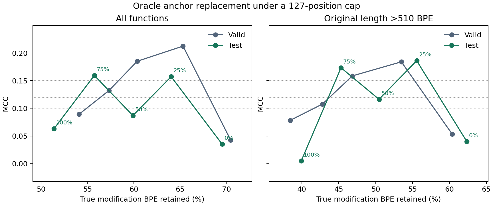

# LongVul

PrimeVul_original 长函数漏洞检测基线。实验采用 RGCL 的原始配对划分，Train、Valid、Test 分别有 8,708、1,124、1,128 个函数。每个函数独立输入和分类。采用种子 42、验证集 MCC 选模（并列取最早轮）和固定判定规则 `p > 0.5`。长度按对应编码器的未截断正文 BPE 数分层。

## LongVul 1024

正式 LongVul 从单个原始函数生成输入。历史配对差异监督区域定位器，定位器的预测与 Joern 原生程序依赖共同决定保留哪些代码。显式标注的 Oracle 对照在所有划分使用真实配对版本，其结果仅适用于特权信息协议。

### 源码、区域与依赖

1. Tree-sitter C++ 提供注释、字面量和语句边界。删除普通注释的内容，保留分隔空格和物理换行。普通行去掉行首、行尾和多余水平空白。保留字面量、可能含预处理指令的整行，以及含换行续接或字面量无法确认的整个函数。每个简化字符保留原字符坐标，合成空格另外标记。用同一 UniXcoder 分别计原始与简化后的 BPE。实际修改保留率的分母使用原始 BPE，只有原字符范围完整可见的原始 token 才进入分子。
2. 区域以完整语句、控制头、函数头和按行分割的其余连续源码组成。定位器把每个区域的全部 BPE 按顺序放入四个词向量均值池，以冻结的 UniXcoder 输入词表、小型卷积和区域分类头输出预测分数。训练信号是区域与历史实际修改行或空侧邻近行的重叠。定位器使用类加权区域 BCE，在完整 Valid 上按区域 AP 选模。分数代表预测的修复相关性。
3. 用本机 Joern 4.0.465、Java 21 和 NEWC 对原始函数批量构图。PrimeVul_original 配对记录缺少原始文件路径、语言字段和编译数据库。单函数入口优先用已知扩展名，其余函数使用明确的 C++ 语法特征区分 C++，其余按 C 解析。C2CPG 按输入扩展名选择 CDT 解析器。原始函数中省略返回类型的 C 代码可在 C 方言下解析。[C2CPG 方言选择](https://github.com/joernio/joern/blob/v4.0.465/joern-cli/frontends/c2cpg/src/main/scala/io/joern/c2cpg/parser/CdtParser.scala)
4. 使用 `--log-problems --log-preprocessor --enable-file-content` 和 `SL_LOGGING_LEVEL=INFO`。通过导出检查 CFG 和 dataflow overlay，按文件、位置与 Joern `CODE` 前缀定位定义。读取 `REACHING_DEF` 与 `CDG`，先映射原始语句再映射简化 BPE。表达式直接坐标无法验证时，仅在明确的 Joern 表达式 AST 归属下映射。缺失端点与重复语句级边分别记录。仅选择一跳上游依赖。LLMxCPG 的实现用 Joern 节点 ID 和原始行号回查源码。LongVul 沿用原文回查思路并检查列号，区分同一行的多个语句。[Joern 导出](https://docs.joern.io/export/) · [CPG 规范](https://cpg.joern.io/#pdg) · [LLMxCPG 定位实现](https://github.com/qcri/llmxcpg/blob/fd7af0df8d2221ec196b85bc460da5cb40f6866c/queries/Components/joern_manager.py#L204)

每个普通批次最多 128 个文件和约 1 MB 源码，超过 128 KiB 的单个函数隔离。保留 Joern 默认的 4,000 定义数据流上限。批次、文件、CFG 完整性、原生边可用性和映射计数分别统计。DDG 和 CDG 单项分别要求对应类型有可用映射，PDG 同时要求两类。在构图失败或缺少所需映射时，Oracle 使用原修改区与均匀补充，LongVul 使用原预测区域及全局覆盖与均匀补充。逐组记录依赖可用、无有效依赖和构图或匹配失败。全部样本参与原划分的评价，另报告 DDG 和 CDG 都有有效边的共同样本。[Joern 定义上限](https://github.com/joernio/joern/blob/v4.0.465/joern-cli/src/main/scala/io/joern/joerncli/DefaultOverlays.scala)

### 预算与对照

所有输入最多 1,024 位置。原始版本的相对顺序由简化序列中的区间保持，CLS、末尾 EOS 和区间间的 EOS 都计入实际长度。短函数保留全部简化正文。Oracle 共享相同真实修改区和空侧锚点，补充动作保留已选锚点。Predicted Region 与 LongVul 在 Train、Valid、Test 均用同一个冻结定位器的预测。

LongVul 按函数长度建立最多六个空间区间，先保留各区可容纳的完整代表区域，再让区域相关性、空间距离和一跳边收益共同争取剩余预算。每次比较单个区域和一跳两端同时加入的增量，重新计算两端新增完整可见的唯一 DDG/CDG 边和实际新增位置。距离不超过 8 个 BPE 的间隔可并成一个片段。每增加一个片段在排序代价中计 8 个 BPE 等价成本，实际预算仍以打包 token 为准。片段上限为 12，Oracle 若有超过 12 个已保留的修改片段，则以上限为其锚点片段数。全局覆盖按完整区域的实际大小分配。

| 对照 | 输入选择 |
| --- | --- |
| Uniform Sampling / Context-Aware Selection | 同预算的空间均匀基线和原语法关联基线，共用简化与评价。 |
| Oracle-Diff / Oracle-Diff+Syntax | 共享真实修复锚点，分别补充均匀窗口或条件、声明、赋值。 |
| Oracle-Diff+DDG / CDG / PDG | 共享锚点，分别用 `(1,0)`、`(0,1)`、`(1,1)` 的原生边权。 |
| Oracle-Diff+PDG-Weighted | 在训练和完整验证集比较 `(1,1)`、`(1,2)`、`(2,1)`。Test 仅报告胜出配置及预先登记的等权对照。 |
| Predicted Region / LongVul | 共享区域预测与全局覆盖，LongVul 加入按 Valid 选中的 PDG 权重。 |

正式单函数预测写入后才计算 Test 的真实差异，用于保留率、定位器诊断和特权 Oracle。模型沿用原 UniXcoder-base-nine 的 1,026 行位置表和 RGCL 分类头。所有 1,024 位置分类器使用 BF16 autocast、FP32 参数、SDPA、函数级 BCE、LOSVERAdamW、16 轮、有效 batch 8 和学习率 2e-5。区域定位器和分类器各自保存最优权重。`run` 和 `predict` 使用本轮检查点对应的填充策略。

```bash
export CUDA_VISIBLE_DEVICES=0 HF_HUB_OFFLINE=1 RAYON_NUM_THREADS=6 TOKENIZERS_PARALLELISM=true
PYTHON=/home/phy/miniconda3/envs/vul-detect/bin/python
"$PYTHON" longvul.py smoke
"$PYTHON" longvul.py run
"$PYTHON" longvul.py predict --source function.cpp
```

### PrimeVul_original 正式结果

种子 42 的 11 组分类器均完成 16 轮。表中的长组按原始 BPE 计，共 477 个函数，其中 396 个在简化后仍需选择。Oracle 行使用 Test 的真实修复版本。

| 方法 | 整体 MCC | 整体 F1 | ROC-AUC | PR-AUC | >1022 MCC | >1022 F1 |
| --- | ---: | ---: | ---: | ---: | ---: | ---: |
| Uniform Sampling | 0.0426 | 0.3978 | 0.5206 | 0.5274 | 0.0000 | 0.0000 |
| Context-Aware Selection | 0.0621 | 0.5404 | 0.5519 | 0.5593 | 0.0423 | 0.5483 |
| Predicted Region | 0.0496 | 0.5240 | 0.5451 | 0.5458 | 0.0016 | 0.4893 |
| LongVul | 0.0728 | 0.3473 | 0.5684 | 0.5636 | 0.0246 | 0.2109 |
| Oracle-Diff | 0.1242 | 0.5542 | 0.5841 | 0.5743 | 0.1397 | 0.5372 |
| Oracle-Diff+Syntax | 0.1083 | 0.5431 | 0.5719 | 0.5679 | 0.0983 | 0.5416 |
| Oracle-Diff+DDG | 0.0403 | 0.0733 | 0.5532 | 0.5507 | 0.0000 | 0.0000 |
| Oracle-Diff+CDG | 0.0941 | 0.6171 | 0.5737 | 0.5658 | 0.0393 | 0.5868 |
| Oracle-Diff+PDG (1:1) | 0.0421 | 0.0071 | 0.5068 | 0.5109 | 0.0000 | 0.0000 |
| Oracle-Diff+PDG-Weighted (2:1) | 0.1137 | 0.5712 | 0.5787 | 0.5595 | 0.0695 | 0.5356 |

LongVul 的整体 MCC 和两项 AUC 高于两个单函数基线。其 F1 低于两个基线，长组 MCC 低于 Context-Aware，≥2041 BPE 组 MCC 为 −0.0063。这次单种子结果未显示长函数上有一致的检测增益。完整 Valid 选择了 2:1，MCC 为 0.1360，另两组 1:2 和 1:1 分别为 0.1336 和 0.0299。加权组在 Test 上高于等权组，但在长组低于 Oracle-Diff 与 Oracle-Diff+Syntax。

### 区域、输入和计算成本

- 在 Test 上，源码简化节省 329,043 个 BPE（16.0%）。仅改变选择预算时，>1022 BPE 组的原始修改 BPE 保留率从 512 到 1024 分别为 Uniform 22.3% → 44.7%、Context-Aware 20.5% → 43.2%、Oracle-Diff 77.0% → 81.7%、Predicted Region 24.4% → 47.6%、LongVul 22.6% → 44.9%。这一比较使用相同简化源码和定位器，测量输入保留率。
- 定位器在 Train、Valid、Test 的区域 AP 分别为 0.1373、0.0699、0.0511。每个 Test 函数的前五区域合计命中 8.1% 的正区域，有至少一个命中的函数占 44.7%。标签来自历史修改和空侧邻近区域。
- 在 1,128 个 Test 函数中，990 个有通过检查的目标函数和 CFG，976 个有可用 DDG，932 个有可用 CDG，928 个两类都可用。PDG 组有 62 个函数缺少要求的有效依赖，另有 138 个目标函数未匹配或位置无法验证。所有函数均纳入总体评价。共同具有两类依赖且简化后仍需选择的 311 个函数上，Oracle-Diff、Oracle-Diff+Syntax 和加权 PDG 的 MCC 分别为 0.1187、0.1380、0.0865。
- 对 >1022 BPE 的函数，LongVul 相比 Predicted Region 保留了更多两端可见的 DDG（103,102 对 60,393）和 CDG（22,181 对 17,544）。每函数平均片段数为 8.85 对 8.96，Context-Aware 为 18.14。片段长度中位数分别为 59、61、13 BPE。全 Test 中 LongVul 有 13/564 对输入相同，Uniform 有 11/564 对，全部 Oracle 对照为 0/564 对。
- 训练集到测试集的 Joern 构图与导出分别耗时 3,635.6、344.1、397.9 秒，源码映射另耗时 150.7、14.6、19.4 秒。Test 源码分析、简化、分词和区域映射共 32.1 秒，定位器评分 2.03 秒，LongVul 联合选择 353.31 秒，UniXcoder 推理 2.77 秒。LongVul 的训练集选择耗时 2,984.72 秒，分类器优化用时 31.13 分钟，训练与推理峰值分别为 4.97、0.88 GiB。

各长度组的 MCC、F1、ROC-AUC、PR-AUC，逐组的输入、依赖和耗时统计，以及配置、逐轮记录和逐样本预测位于 [`results/longvul1024/`](results/longvul1024)。本地检查点位于 `checkpoints/longvul1024/`。

### 连续填充

在正式实验收尾后，沿用仓库中的双向扩展实现。填充优先补全已选 AST 语句或控制头，边界不可靠时补全物理行。只在尚未覆盖的位置区间少量引入完整单元。其余预算轮流扩展现有片段，合并后的 BPE 与内部 SEP 按实际占用计算。已选实际修改、预测区和程序依赖范围均由区间并集保留。

`longvul.py audit-fill` 使用相同 Test 样本、定位器、已选范围和 Joern 缓存比较两种填充。两组各 1,128 个函数均保留了填充前的全部区域，最大输入均为 1,024 位置。在 >1022 BPE 的 477 个函数上测得以下变化。正式分类结果来自原输入构造。[本轮正式实验版本](https://github.com/puhaoyang78/LongVul/commit/25af2a869d5434540ed049a294a24fd67f70b068)

| 方法 | 平均片段数 | 平均片段长度 | 中位片段长度 | 内部 SEP 总数 | 原始 BPE 覆盖率 | 平均覆盖的源码四分区数 |
| --- | ---: | ---: | ---: | ---: | ---: | ---: |
| LongVul | 8.85 → 8.65 | 112.56 → 115.25 | 59 → 70 | 3,745 → 3,647 | 25.505% → 25.513% | 3.99 → 3.99 |
| Oracle-Diff+PDG-Weighted | 6.40 → 3.17 | 155.93 → 316.50 | 97 → 235 | 2,578 → 1,033 | 25.57% → 25.64% | 3.96 → 3.56 |

长组实际修改 BPE 保留率在加权 Oracle 中为 81.66%（两种填充相同），在 LongVul 中从 44.85% 降至 44.63%。全 Test 中 LongVul 的成对输入碰撞从 13 增至 16，Oracle 维持 0。连续填充在本轮只做输入验证。详细分层、语句完整性和依赖覆盖见 [`continuous_fill.json`](results/longvul1024/continuous_fill.json)。

```bash
"$PYTHON" longvul.py audit-fill
"$PYTHON" -m unittest discover -s tests -v
```

## UniXcoder 修复区域 Oracle（特权信息）

512-token 的两种 Oracle 和 Predicted-Diff 共用历史居中填充与打包。已发布的 Uniform Sampling 和 Context-Aware 对照也来自历史版本。复现这两个对照时在历史版本运行对应命令。[历史实验版本](https://github.com/puhaoyang78/LongVul/commit/9d9536371b20ae3ea445254d8b4a4a6f36e252e1)

**Train、Valid 和 Test 的 Oracle 输入都使用划分内的真实配对版本。** 表中的分数只描述该离线协议的实测表现。输入选择需要已知真实修复，常规单函数推理缺少这个条件。

两组对同一原始配对做一次保留行尾的行级对齐。先移除完全相同的前后缀，再在中间区域使用 `SequenceMatcher(autojunk=False)`。替换块在两侧各自选原文。删除块的漏洞侧和插入块的修复侧选实际存在的修改行。另一侧在匹配位置选前后各一条原始行，文件边缘取可用的一条。行区间通过字符偏移映射到原始 UniXcoder BPE，跨行 token 按位置去重。沿用已有缩进简化，保留原 token ID、源码顺序及通用 EOS 间隔。

| 方法 | 512 位置内的选择顺序 |
| --- | --- |
| Oracle-Diff | 实际修改区、无对应修改行一侧的邻近行、均匀补充。 |
| Oracle-Diff+Context | 保留同一组优先区，再补入已有 Tree-sitter 条件头、同名声明和赋值候选，最后均匀补充。 |

超预算时扣除间隔位置，完整保留可容纳的短块，并由较大的块均分剩余正文位置，块内居中保留 BPE。可容纳的块数不足时沿源码顺序等距选择。两组共用同一映射和分配过程，输入只含各自函数的 token 和通用特殊 token。补充语法关系的打分沿用条件头 3、声明和赋值 2 的权重及新增位置成本。简化后能放下的函数保留全部正文。修复区统计采用原始 BPE 分母，插入或删除发生时无对应修改行一侧的邻近行单独统计。

两组各训练一个独立函数分类器。沿用同一 UniXcoder-base-nine、单次编码、BCE、种子 42、16 轮、batch 8、学习率 2e-5、LOSVERAdamW、10% 线性预热、验证 MCC 选模和固定阈值。比较使用已经保存的 Uniform Sampling 和 Context-Aware Selection 预测。配置、逐轮指标和逐样本结果保存在 `results/unixcoder_repair_oracle/`，检查点保存在服务器 `checkpoints/unixcoder_repair_oracle/`。

```bash
export CUDA_VISIBLE_DEVICES=0 HF_HUB_OFFLINE=1 RAYON_NUM_THREADS=6 TOKENIZERS_PARALLELISM=true
PYTHON=/home/phy/miniconda3/envs/vul-detect/bin/python
"$PYTHON" paired.py oracle_diff oracle_diff_context --smoke-only
"$PYTHON" paired.py oracle_diff oracle_diff_context
```

### 测试表现

| 长度（BPE） | 函数数 | 方法 | MCC | F1 | ROC-AUC | PR-AUC |
| --- | ---: | --- | ---: | ---: | ---: | ---: |
| 整体 | 1,128 | Uniform Sampling | 0.0880 | 0.5043 | 0.5599 | 0.5644 |
| 整体 | 1,128 | Context-Aware Selection | 0.1199 | 0.4572 | 0.5591 | 0.5575 |
| 整体 | 1,128 | Oracle-Diff | 0.2111 | 0.6107 | 0.6651 | 0.6564 |
| 整体 | 1,128 | Oracle-Diff+Context | 0.2352 | 0.5970 | 0.6619 | 0.6501 |
| >510 | 732 | Uniform Sampling | 0.0465 | 0.4441 | 0.5313 | 0.5260 |
| >510 | 732 | Context-Aware Selection | 0.0935 | 0.3978 | 0.5357 | 0.5305 |
| >510 | 732 | Oracle-Diff | 0.2620 | 0.6076 | 0.7121 | 0.6920 |
| >510 | 732 | Oracle-Diff+Context | 0.2666 | 0.5918 | 0.6937 | 0.6709 |
| 511–1,020 | 254 | Uniform Sampling | 0.1082 | 0.4695 | 0.5782 | 0.5834 |
| 511–1,020 | 254 | Context-Aware Selection | 0.0963 | 0.3784 | 0.5498 | 0.5427 |
| 511–1,020 | 254 | Oracle-Diff | 0.2440 | 0.6160 | 0.6694 | 0.6498 |
| 511–1,020 | 254 | Oracle-Diff+Context | 0.2447 | 0.5714 | 0.6824 | 0.6513 |
| 1,021–2,040 | 224 | Uniform Sampling | 0.0750 | 0.4526 | 0.5420 | 0.5439 |
| 1,021–2,040 | 224 | Context-Aware Selection | 0.1553 | 0.4667 | 0.5613 | 0.5738 |
| 1,021–2,040 | 224 | Oracle-Diff | 0.3220 | 0.6091 | 0.7691 | 0.7578 |
| 1,021–2,040 | 224 | Oracle-Diff+Context | 0.2520 | 0.6000 | 0.6800 | 0.6678 |
| ≥2,041 | 254 | Uniform Sampling | -0.0376 | 0.4126 | 0.4729 | 0.4717 |
| ≥2,041 | 254 | Context-Aware Selection | 0.0319 | 0.3511 | 0.4961 | 0.4911 |
| ≥2,041 | 254 | Oracle-Diff | 0.2352 | 0.5975 | 0.7066 | 0.6957 |
| ≥2,041 | 254 | Oracle-Diff+Context | 0.3008 | 0.6044 | 0.7130 | 0.6921 |

已知修复位置在此离线条件下提供了超出均匀采样的判别信息。Oracle-Diff 在长函数上的 MCC、F1、ROC-AUC 和 PR-AUC 均高于两个对照。相对 Uniform Sampling，长函数 MCC 增加 0.2156。添加语法上下文后，整体 MCC 增加 0.0241，长函数只增加 0.0045，整体和长函数的 F1、ROC-AUC、PR-AUC 均下降。长函数精确率从 0.6372 升至 0.6522，召回率从 0.5806 降至 0.5417。MCC 的变化因长度组而异，1,021–2,040 BPE 降低 0.0700，≥2,041 BPE 增加 0.0657。此次单种子结果只支持特定分层和固定阈值下的上下文增益。PR-AUC 使用 average precision。

### 修改保留与输入碰撞

| Test 范围 | 方法 | 实际修改合计 | 替换 | 删除 | 纯插入 | 插入原侧邻近行 | 删除修复侧邻近行 |
| --- | --- | ---: | ---: | ---: | ---: | ---: | ---: |
| 整体 | Uniform Sampling | 51.7% | 52.5% | 44.1% | 50.8% | 55.1% | 48.8% |
| 整体 | Context-Aware Selection | 49.7% | 50.6% | 44.4% | 47.8% | 56.0% | 49.6% |
| 整体 | 两种 Oracle | 91.4% | 91.2% | 91.6% | 91.9% | 89.9% | 83.8% |
| >510 | Uniform Sampling | 40.4% | 40.3% | 34.7% | 41.3% | 37.3% | 40.6% |
| >510 | Context-Aware Selection | 37.8% | 38.0% | 35.1% | 37.7% | 38.5% | 41.6% |
| >510 | 两种 Oracle | 89.4% | 89.0% | 90.1% | 90.3% | 85.9% | 81.2% |
| ≥2,041 | Uniform Sampling | 15.2% | 15.0% | 12.4% | 16.1% | 10.6% | 18.6% |
| ≥2,041 | Context-Aware Selection | 11.9% | 11.9% | 5.0% | 12.7% | 12.1% | 16.0% |
| ≥2,041 | 两种 Oracle | 85.4% | 85.0% | 88.2% | 86.1% | 75.5% | 66.3% |

统计按各长度范围内的原始 BPE 微平均。替换、删除、插入均以单个 diff 块为单位归类，合计对三类实际修改位置取并集。两种 Oracle 在长函数上均保留 52,267 / 58,483 个实际修改 BPE，各类型的保留计数也完全一样。716 个需要选段的测试函数中，加入上下文改变了 603 个函数的选段。调用 Tree-sitter 的 696 个函数中，241 个带语法错误标志，局部可解析单元仍参与候选提取。[分层逐类型计数](results/unixcoder_repair_oracle/edit_retention.json)

| 方法 | 整体相同输入 | >510 相同输入 | ≥2,041 相同输入 | >510 平均有效位置 / 正文 BPE |
| --- | ---: | ---: | ---: | ---: |
| Uniform Sampling | 20/564 | 20/374 | 13/130 | 511.61 / 503.66 |
| Context-Aware Selection | 32/564 | 32/374 | 21/130 | 511.61 / 494.91 |
| Oracle-Diff | 0/564 | 0/374 | 0/130 | 511.61 / 504.86 |
| Oracle-Diff+Context | 0/564 | 0/374 | 0/130 | 511.61 / 501.73 |

按配对两侧较长的原始 BPE 长度分层，逐对比较实际输入 token ID 序列。两种 Oracle 的成对输入碰撞数均为零，分类指标仍不同。预检用纯插入、纯删除、多块修改和 232,766 BPE 的真实配对验证源码映射、间隔预算和单次编码。复算使用逐样本的原始 `source_runs`、`repair_bpe_spans` 和 `oracle_anchor_runs`。[预检](results/unixcoder_repair_oracle/smoke.json) · [两种 Oracle 的配置、预测和检查点指标](results/unixcoder_repair_oracle/)

### 计算成本

| 方法 | 入选轮次 | 验证 MCC | 优化（分钟） | Train / Valid / Test 预处理（秒） | Test 推理（秒） | 训练 / 推理峰值（GiB） |
| --- | ---: | ---: | ---: | ---: | ---: | ---: |
| Uniform Sampling | 7 | 0.1142 | 36.06 | 56.91 / 6.34 / 7.86 | 4.76 | 6.446 / 0.842 |
| Context-Aware Selection | 9 | 0.1163 | 36.06 | 147.76 / 16.33 / 20.07 | 4.76 | 6.446 / 0.842 |
| Oracle-Diff | 10 | 0.2854 | 35.98 | 81.81 / 8.47 / 10.49 | 4.80 | 6.424 / 0.849 |
| Oracle-Diff+Context | 13 | 0.2643 | 36.01 | 158.26 / 16.95 / 21.90 | 4.80 | 6.446 / 0.871 |

单张 RTX 4090 依次执行两个 Oracle，含预检、验证和检查点写入共用 1 小时 27 分 40 秒。优化时间累加训练步骤。预处理含读取、对齐、分词及选段，推理含批次组装、一次 UniXcoder 编码和预测分数回传。显存为 PyTorch 已分配峰值。原有基线使用已保存的检查点推理测量。Oracle-Diff+Context 比 Oracle-Diff 多用 11.41 秒测试预处理，编码耗时接近。

## UniXcoder 512 Predicted-Diff

将历史 Oracle-Diff 的真实修改区换成定位器预测区。输入沿用 `9d95363` 的缩进简化、块间预算分配、四区居中填充和源顺序 SEP 打包。原始正文 ≤510 BPE 的函数直接保留全文。定位器以同一份简化 BPE 的行单元为输入，沿用冻结的 UniXcoder 词嵌入、局部卷积和类加权区域 BCE。训练标签来自 Train 的历史修改区及纯插入或删除的空侧邻近行。在 Valid 按区域 AP 选定位器。

定位器固定后，仅在 Valid 上比较每函数最多 4 或 8 个预测区域，以及 127、191 或 255 个优先位置。以简化后确实需要选段的 Valid 函数中，打包后的原始修改 BPE 保留率为准，并列时优先采用较小预算及较少区域。每个需要选段的函数至少给均匀填充留出 255 个正文及间隔位置。Train、Valid、Test 分类输入均使用该定位器和固定规则，只读取当前函数。Test 的真实差异在分类预测写入后用于诊断。

分类器沿用历史 FP32 Eager UniXcoder-base-nine、独立函数 BCE、种子 42、16 轮、batch 8、学习率 2e-5、LOSVERAdamW 和 10% 预热。模型按完整 Valid MCC 选择，分类阈值固定 `p > 0.5`。

```bash
export CUDA_VISIBLE_DEVICES=0 HF_HUB_OFFLINE=1 RAYON_NUM_THREADS=6 TOKENIZERS_PARALLELISM=true
PYTHON=/home/phy/miniconda3/envs/vul-detect/bin/python
"$PYTHON" paired.py predicted_diff --smoke-only
"$PYTHON" paired.py predicted_diff
"$PYTHON" -m unittest discover -s tests -v
```

### Predicted-Diff 正式结果

Valid 选出 4 个预测块、最多 127 个优先位置。651 个需要选段的 Valid 函数保留了 38.66% 的实际修改 BPE。定位器取第 5 轮，Train、Valid、Test 的区域 AP 为 0.2010、0.0851、0.0586，Test 长组 AP 为 0.0466。分类器取第 7 轮，Valid MCC 为 0.0948。

| Test 原始 BPE | 函数数 | MCC | F1 | ROC-AUC | PR-AUC |
| --- | ---: | ---: | ---: | ---: | ---: |
| 整体 | 1,128 | 0.0694 | 0.5134 | 0.5542 | 0.5551 |
| >510 | 732 | 0.0440 | 0.4606 | 0.5352 | 0.5203 |
| ≤510 | 396 | 0.1078 | 0.5926 | 0.5873 | 0.5980 |
| 511–1020 | 254 | 0.1099 | 0.5462 | 0.5619 | 0.5377 |
| 1021–2040 | 224 | 0.0092 | 0.4308 | 0.5109 | 0.5188 |
| ≥2041 | 254 | 0.0074 | 0.3842 | 0.5272 | 0.5171 |

| 方法 | 整体 MCC | >510 MCC | >510 修改 BPE 保留率 | 完全相同的配对输入 |
| --- | ---: | ---: | ---: | ---: |
| Uniform-4 | 0.0408 | −0.0015 | 37.97% | 31/564 |
| Uniform Sampling | 0.0880 | 0.0465 | 40.36% | 20/564 |
| Context-Aware | 0.1199 | 0.0935 | 37.79% | 32/564 |
| Oracle-Diff（特权信息） | 0.2111 | 0.2620 | 89.37% | 0/564 |
| Oracle-Diff+Context（特权信息） | 0.2352 | 0.2666 | 89.37% | 0/564 |
| Predicted-Diff | 0.0694 | 0.0440 | 38.55% | 41/564 |

Predicted-Diff 的整体 MCC 比 Oracle-Diff 低 0.1417，长组低 0.2180。整体和长组 MCC 均低于 Uniform Sampling 与 Context-Aware。Predicted-Diff 全 Test 保留 50.27% 的真实修改 BPE。长函数平均包含 6.75 个编码片段，每片段平均 74.60 BPE、中位数 103 BPE，统计使用实际 SEP 分隔。

定位器和分类器的训练步骤分别耗时 6.31 和 36.08 分钟。全 Test 的分词与缩进简化 8.26 秒，定位器打分 1.32 秒，选段打包 1.09 秒，UniXcoder 分类 4.79 秒。分类器训练和推理峰值显存分别为 6.42 和 0.87 GiB。36 对真实 Valid 函数的两种 Oracle 布局均逐项匹配历史提交。

配置、区域策略、逐轮指标、预测及五个历史对照的完整分层比较见 [`results/unixcoder_predicted_diff/`](results/unixcoder_predicted_diff)。定位器和分类器的最佳与续训检查点保存在服务器 `checkpoints/unixcoder_predicted_diff/`。

## 修改区域定位质量

Oracle 噪声实验共用历史 512 位置的 UniXcoder FP32 Eager 训练入口、缩进简化、居中均匀填充与打包。用 Predicted-Diff 已保存的策略固定最多 4 个同口径行单元、127 个优先位置。0% 组按与实际修改 BPE 的重叠选择行单元，空侧邻近行用于并列和补充。各档从这组保留块中按种子 42 派生的固定顺序替换，目标是在每个划分分别尝试替换 0%、25%、50%、75%、100%。替代区从当前函数的未修改区选取，长度和间隔位置开销保持一致。无法匹配的块保留原位并单独计数。整个噪声实验含 Test 都使用特权差异信息。完整预算 Oracle 和历史预测基线均直接读取已保存结果。

两个定位器在相同的历史行单元和 diff 弱标签上评价，共用 512 位置打包。上下文定位器借鉴 LLMAO 的冻结模型表示和可训练定位头。每个函数完整地覆盖在至多 512 位置的非重叠窗口中，按行单元汇聚 UniXcoder 末层隐藏状态。定位头沿用原有的四个连续均值池与卷积，以 Valid AP 选检查点。FIM 定位器借鉴 ANVIL 的掩码重建损失，以固定版本的 Qwen2.5-Coder-0.5B 为每个行单元计算零样本 teacher-forcing 平均 NLL。每侧最多读 64 个该模型的原始代码 token。[LLMAO 论文](https://arxiv.org/abs/2310.01726) · [LLMAO 表示提取](https://github.com/squaresLab/LLMAO/blob/master/codegen_loading.py) · [ANVIL 论文](https://arxiv.org/abs/2408.16028) · [ANVIL 损失实现](https://github.com/joe-weizhou-wang/anvil-paper/blob/main/llm_code_gen/helpers.py)

定位器各自沿用 Predicted-Diff 的六个预算候选，在 Valid 冻结选段策略，并同时报告固定 4 区、127 位置的对照。下游分类门槛使用 Valid 原始长度 >510 BPE 的组，要求真实修改 BPE 保留率至少 58%，且较历史 Uniform Sampling 高至少 5 个百分点。Test 的分数与输入固定后才读取真实差异计算质量指标。

将固定版本的 Qwen 权重和 tokenizer 放在本地 `checkpoints/locator_quality/qwen2.5-coder-0.5b/`。[Qwen2.5-Coder-0.5B 固定版本](https://huggingface.co/Qwen/Qwen2.5-Coder-0.5B/tree/8123ea2e9354afb7ffcc6c8641d1b2f5ecf18301)

```bash
export CUDA_VISIBLE_DEVICES=0 HF_HUB_OFFLINE=1 RAYON_NUM_THREADS=6 TOKENIZERS_PARALLELISM=true
PYTHON=/home/phy/miniconda3/envs/vul-detect/bin/python
"$PYTHON" paired.py oracle_noise --smoke-only
"$PYTHON" paired.py oracle_noise
"$PYTHON" locator_quality.py contextual fim
"$PYTHON" -m unittest discover -s tests -v
```

### Oracle 噪声敏感性结果

Valid 长组在 0% 同预算 Oracle 下保留 60.38% 的真实修改 BPE。历史完整 Oracle、Predicted-Diff 和 Uniform Sampling 分别为 86.89%、39.28% 和 38.52%。这组比较先于分类训练。Test 长组的对应保留率为 62.36%、89.37%、38.55% 和 40.36%。完整 Oracle 的优先位置预算与本实验不同。

| 目标替换比例 | Test 实际替换比例 | 整体修改 BPE 保留率 | 整体 MCC | >510 BPE 保留率 | >510 MCC | Test 相同配对输入 |
| ---: | ---: | ---: | ---: | ---: | ---: | ---: |
| 0% | 0.00% | 69.55% | 0.0351 | 62.36% | 0.0398 | 1/564 |
| 25% | 24.84% | 64.04% | 0.1572 | 55.56% | 0.1861 | 0/564 |
| 50% | 49.60% | 59.91% | 0.0869 | 50.46% | 0.1164 | 0/564 |
| 75% | 74.22% | 55.74% | 0.1595 | 45.31% | 0.1734 | 0/564 |
| 100% | 99.13% | 51.39% | 0.0629 | 39.92% | 0.0053 | 0/564 |

五组在 Test 都有 1,381 个保留块和相同的 33,631 个优先位置。100% 组的 12 个块没有找到长度合法的替代区，保留原位置。输入碰撞在实际修改保留率下降时也会消失。替换采样对每个函数独立进行，输入差异可来自任何被选源码。



下表给出 MCC 严格超过目标的**最低实测保留率**。非单调曲线在多个区间过线，无法把这些观测点解释为必要门槛。0% 组在最后一轮的训练 BCE 为 0.6935，Valid 选中第 1 轮。本实验为一个训练种子，分类学到的判别能力也影响曲线。

| MCC 目标 | Valid 整体 | Test 整体 | Valid 长组 | Test 长组 |
| ---: | ---: | ---: | ---: | ---: |
| >0.10 | 57.34% | 55.74% | 42.78% | 45.31% |
| >0.12 | 57.34% | 55.74% | 46.84% | 45.31% |
| >0.15 | 60.37% | 55.74% | 46.84% | 45.31% |

每组在单张 RTX 4090 上的分类优化耗时 35.85 至 35.94 分钟。全部长度组的 MCC、F1、ROC-AUC、PR-AUC、选中轮次、过线位置和实际噪声比例见 [`summary.json`](results/oracle_noise_512/summary.json)。配置、逐轮指标和逐样本预测保存在同目录。

### 定位器结果

| 方法 | Valid 整体 AP | Test 整体 AP | Test 长组 AP | Test 长组 Recall@1 / @5 / @10 | Valid 长组修改保留率 | Test 长组修改保留率 |
| --- | ---: | ---: | ---: | ---: | ---: | ---: |
| Uniform Sampling | — | — | — | — | 38.52% | 40.36% |
| 历史词嵌入定位器 | 0.0851 | 0.0586 | 0.0466 | 1.43% / 6.56% / 12.84% | 39.28% | 38.55% |
| 上下文隐藏状态，8 区 / 191 位置 | 0.1190 | 0.0947 | 0.0676 | 1.87% / 8.07% / 15.29% | 39.86% | 40.84% |
| FIM 重建损失，4 区 / 127 位置 | 0.0397 | 0.0317 | 0.0271 | 0.98% / 4.98% / 10.02% | 38.19% | 40.46% |

固定 4 区、127 位置时，上下文定位器的 Valid 和 Test 长组保留率为 38.57% 和 39.98%。采用 Valid 选出的 8 区、191 位置时，Valid 比 Uniform Sampling 高 1.34 个百分点。两种新定位器都低于预定门槛，本轮分类训练止于五档 Oracle 对照。

上下文定位器的 Train 特征提取耗时 54.96 秒，定位头训练耗时 323.25 秒。Test 的 192,930 个区域共用 4,432 个窗口和 185 次批量编码，提取与打分合计 8.31 秒，峰值显存 0.53 GiB。FIM 对相同区域逐个遮蔽，共 3,015 次批量前向，Test 打分耗时 289.74 秒，峰值显存 1.37 GiB。两个耗时口径均从已准备的函数开始。完整分层保留率、Recall@K、配置和时序见 [`results/locator_quality_512/`](results/locator_quality_512)。

## UniXcoder 上下文感知选择

三组都使用 RGCL 的 UniXcoder、CLS + `RobertaClassificationHead` 和函数级 BCE，每批只调用一次编码器。训练采用 16 轮、batch 8、学习率 2e-5、LOSVERAdamW、10% 线性预热、梯度裁剪 1 和 FP32 eager。模型与 tokenizer 从同一固定版本的本地目录加载。[UniXcoder 固定版本](https://huggingface.co/microsoft/unixcoder-base-nine/tree/5f0dc256eb0904af496d427451da5d7f90261676)

| 方法 | 正文选择 |
| --- | --- |
| Uniform-4 | 沿用历史四区中心窗口及 126/127/127/127 的正文预算。 |
| Uniform Sampling | 四区各保留一个至多 88 BPE 的中心窗口，剩余位置用于四区内各自最大空档的居中补充。 |
| Context-Aware Selection | 使用相同四个基础窗口，优先补入相关语法单元，余量沿用 Uniform Sampling 的填充策略。 |

Tree-sitter C++ 在完整源码上定位四个基础窗口所及的条件头与语句。候选包括其所属代码块的条件头、已选标识符在当前或外层词法作用域中较早的同名声明和简单赋值、相邻语句，以及已选语句的缺失部分。候选分数为关联权重之和除以新增位置数。条件头权重 3，声明、赋值、补全权重 2，相邻语句权重 1。选取按源码顺序打包，每个间隔使用一个 EOS。补充组按行边界挑选均匀窗口，最后在已保留片段边缘消化对齐余量。两组对仍需选择的长函数均使用 512 个有效位置，包含首尾标记及间隔。原始正文 ≤510 BPE 时保留全部原始 token。

同名引用只构成词法候选。测试共保留率基于三组共享的关系集合。关系连接一个与基础窗口相交的语法单元和一个基础窗口未完整保留的候选语句或条件头。共保留要求两端的全部压缩正文 token 均可见。测试输入相同率逐对比较实际 token ID 序列，按配对中较长一侧的原始 UniXcoder BPE 长度分层。

在 GPU-SERVER-3 使用相邻的 RGCL 仓库（提交 `d8570b98fabe92caf15bcc075ac7796ef307b3b3`）、`../../data/PrimeVul_original` 和 `../../../resource/unixcoder-base-nine`。解析使用 `tree-sitter==0.25.2` 和 `tree-sitter-cpp==0.23.4`。最佳与续训检查点保存在 `checkpoints/unixcoder_context/`。

```bash
export CUDA_VISIBLE_DEVICES=0 HF_HUB_OFFLINE=1 RAYON_NUM_THREADS=6 TOKENIZERS_PARALLELISM=true
PYTHON=/home/phy/miniconda3/envs/vul-detect/bin/python
"$PYTHON" paired.py uniform4 uniform_sampling context_aware --smoke-only
"$PYTHON" paired.py uniform4 uniform_sampling context_aware
```

### 测试结果

| 长度（BPE） | 函数数 | 方法 | MCC | F1 | ROC-AUC | PR-AUC |
| --- | ---: | --- | ---: | ---: | ---: | ---: |
| 整体 | 1,128 | Uniform-4 | 0.0408 | 0.5165 | 0.5409 | 0.5374 |
| 整体 | 1,128 | Uniform Sampling | 0.0880 | 0.5043 | 0.5599 | 0.5644 |
| 整体 | 1,128 | Context-Aware | 0.1199 | 0.4572 | 0.5591 | 0.5575 |
| >510 | 732 | Uniform-4 | -0.0015 | 0.4711 | 0.5113 | 0.5047 |
| >510 | 732 | Uniform Sampling | 0.0465 | 0.4441 | 0.5313 | 0.5260 |
| >510 | 732 | Context-Aware | 0.0935 | 0.3978 | 0.5357 | 0.5305 |
| ≤510 | 396 | Uniform-4 | 0.1133 | 0.5902 | 0.5818 | 0.5764 |
| ≤510 | 396 | Uniform Sampling | 0.1552 | 0.5956 | 0.6034 | 0.6100 |
| ≤510 | 396 | Context-Aware | 0.1586 | 0.5459 | 0.5946 | 0.5910 |
| 511–1,020 | 254 | Uniform-4 | 0.0372 | 0.4874 | 0.5244 | 0.5227 |
| 511–1,020 | 254 | Uniform Sampling | 0.1082 | 0.4695 | 0.5782 | 0.5834 |
| 511–1,020 | 254 | Context-Aware | 0.0963 | 0.3784 | 0.5498 | 0.5427 |
| 1,021–2,040 | 224 | Uniform-4 | 0.0625 | 0.5291 | 0.5358 | 0.5198 |
| 1,021–2,040 | 224 | Uniform Sampling | 0.0750 | 0.4526 | 0.5420 | 0.5439 |
| 1,021–2,040 | 224 | Context-Aware | 0.1553 | 0.4667 | 0.5613 | 0.5738 |
| ≥2,041 | 254 | Uniform-4 | -0.0995 | 0.3983 | 0.4747 | 0.4766 |
| ≥2,041 | 254 | Uniform Sampling | -0.0376 | 0.4126 | 0.4729 | 0.4717 |
| ≥2,041 | 254 | Context-Aware | 0.0319 | 0.3511 | 0.4961 | 0.4911 |

相对同预算的 Uniform Sampling，上下文组的整体 MCC 提升 0.0319，长函数 MCC 提升 0.0470。长函数精确率由 0.5226 升至 0.5699，召回率由 0.3861 降至 0.3056，F1 由 0.4441 降至 0.3978。长函数 ROC-AUC 和 PR-AUC 分别提高约 0.0044 和 0.0045，整体两项排序指标均略低。本次结果支持固定阈值下的 MCC 收益，收益集中在 >1,020 BPE 的长函数。PR-AUC 使用 average precision。

### 输入与共保留

| 方法 | 整体成对相同输入 | >510 成对相同输入 | ≥2,041 成对相同输入 | >510 平均有效位置 / 正文 BPE | >510 关系两端均保留 |
| --- | ---: | ---: | ---: | ---: | ---: |
| Uniform-4 | 31/564（5.5%） | 31/374（8.3%） | 21/130（16.2%） | 492.92 / 488.02 | 6,576/27,461（23.9%） |
| Uniform Sampling | 20/564（3.5%） | 20/374（5.3%） | 13/130（10.0%） | 511.61 / 503.66 | 4,004/27,461（14.6%） |
| Context-Aware | 32/564（5.7%） | 32/374（8.6%） | 21/130（16.2%） | 511.61 / 494.91 | 24,419/27,461（88.9%） |

| >510 BPE 的关系类型 | 关系数 | Uniform-4 | Uniform Sampling | Context-Aware |
| --- | ---: | ---: | ---: | ---: |
| 所属代码块的条件头 | 13,762 | 19.3% | 12.6% | 93.9% |
| 同名声明 | 8,409 | 16.2% | 19.2% | 90.5% |
| 同名赋值 | 2,546 | 26.8% | 14.4% | 81.8% |
| 语句补全 | 619 | 61.7% | 8.4% | 64.8% |
| 相邻语句 | 2,125 | 70.0% | 11.3% | 65.8% |

716 个长函数在简化后仍需选段。上述共保留率按关系计数，每条关系由类型、基础窗口所及的语法单元和候选补充单元去重。语句补全的两端为同一单元。716 个函数中有 248 个在 Tree-sitter 树上出现语法错误标志，分析仍计入其中可解析的完整单元。上下文组用更多间隔位置换取更高的局部共保留率，但成对相同输入净增 12 对。其中 6 对由相同变为可区分，18 对由可区分变为相同。共保留率的提升没有转化为更低的成对相同输入率。

三组的测试平均有效位置依次为 416.25、428.38、428.38。对训练集中最长的 232,766 BPE 函数核对了实际输入 token 与源码索引，并通过钩子确认三组各执行一次 UniXcoder 编码。逐样本记录中的 `source_runs` 为原始 BPE 半开区间。`base_windows` 的每个窗口记录压缩序列及原始序列的起止位置。[极长函数预检](results/unixcoder_context/smoke.json) · [配置、逐轮指标和测试预测](results/unixcoder_context/)

### 计算成本

| 方法 | 入选轮次 | 验证 MCC | 优化（min） | 测试预处理（s） | 测试推理（s） | 训练 / 推理峰值（GiB） |
| --- | ---: | ---: | ---: | ---: | ---: | ---: |
| Uniform-4 | 16 | 0.1121 | 35.98 | 7.96 | 4.75 | 6.424 / 0.842 |
| Uniform Sampling | 7 | 0.1142 | 36.06 | 7.86 | 4.76 | 6.446 / 0.842 |
| Context-Aware | 9 | 0.1163 | 36.06 | 20.07 | 4.76 | 6.446 / 0.842 |

单张 RTX 4090 上，三组含预检、数据处理、验证和写检查点共用 2 小时 14 分 47 秒。表中优化时间仅累加训练步骤。预处理含读取数据、分词和选段。推理时间含批次组装、GPU 编码和分数回传。显存为 PyTorch 已分配显存的峰值。检查点序列化对象曾使约 0.94 GiB 优化器张量延迟释放。正式入口已在最终评估前回收这些对象。表中推理成本取 `checkpoint_inference` 中独立重载最佳检查点的测量。验证与测试分数逐样本复现，训练进程内的原始推理测量也记录在 `metrics.json` 中。相对同预算均匀组，上下文组的测试 CPU 预处理增加 12.21 秒，UniXcoder 推理耗时和显存接近。

## Compaction–Selection–Position Encoding

Uniform-4 的历史测试 MCC 在整体、>510 BPE 和 ≥2,041 BPE 上分别为 0.1015、0.0967 和 0.0660。本实验复用该次结果，并训练 A+B、A+C、A+B+C 三组。各组沿用 16 轮、batch 8、学习率 2e-5、LOSVERAdamW、10% 线性预热、梯度裁剪 1、FP32 eager 和函数级 BCE。[Uniform-4 原始结果](https://github.com/puhaoyang78/LongVul/tree/e094c1ef8bd5e56b08f154a416f89a9eb9c3ecf6/results/paired/uniform4)

- **A，候选窗口。** 复用 Uniform-4 的缩进处理、行边界与超长行切点。保留原始 BPE 索引。原始正文 ≤510 BPE 的函数原样打包，压缩后能完整放入的长函数保留全部压缩正文。其余函数按齐行后的四个位置区间分配 126/127/127/127 个正文位置。每区保留历史中心窗口，并在可用起点范围上等距取七个锚点，吸附到相邻代码边界、按窗口去重，每区最多八个。四区按源码顺序拼接，遇到压缩序列中的间隔时插入一个 EOS。
- **B，可学习选择。** 候选评分读取 CodeBERT 输入词表，依次经过宽度 3、16 通道的 1D CNN、GELU、对有效位置的均值池化和 MLP。训练使用温度 1 的 Straight-Through Gumbel-Softmax，每区前向只使用一个实际窗口。反向把损失梯度传给对齐到同一区内槽位的候选词向量混合，词向量在这条近似路径上停止梯度。CodeBERT 从实际保留的词向量正常更新。推理使用分数 argmax，同分取靠前候选，0 号为历史中心窗口。每个函数最多查表 4×8×127 个候选槽位，随后进行一次 512 位置的 CodeBERT 编码。[Straight-Through Gumbel-Softmax](https://arxiv.org/abs/1611.01144)
- **C，源码位置。** 对原始长函数的保留正文计算 64 档归一化原始 BPE 位置、所属窗口、窗口首尾标记和与上一个窗口的原始间隔。间隔桶为 `1 + floor(log2(gap + 1))`，首个窗口、短函数和特殊 token 使用空特征。各项零初始化 embedding 加到 CodeBERT 的词向量，沿用原生的 RoBERTa 位置 ID 和原始输入预算。A+C 固定使用 Uniform-4 的窗口。

同一 PrimeVul_original 划分逐函数核对了历史与当前 Uniform-4 路径的 token ID、输入长度和原始 BPE 索引。最坏批次预检检查了硬选中词向量与实际送入模型的向量逐值相同、单次前向、非零 BCE 梯度和参数更新。[输入核对](results/csp/input_check.json) · [极长函数预检](results/csp/smoke.json)

### 测试结果

长度分层使用原始正文 BPE。所有指标来自完整验证集 MCC 选中的权重，PR-AUC 使用 average precision。

| 方法 | 选中轮 | 测试分层 | 函数数 | MCC | F1 | ROC-AUC | PR-AUC |
|---|---:|---|---:|---:|---:|---:|---:|
| Uniform-4 | 16 | 整体 | 1,128 | 0.1015 | 0.5275 | 0.5559 | 0.5522 |
| Uniform-4 | 16 | >510 | 823 | 0.0967 | 0.4993 | 0.5490 | 0.5282 |
| Uniform-4 | 16 | ≥2,041 | 346 | 0.0660 | 0.4721 | 0.5280 | 0.5100 |
| A+B | 4 | 整体 | 1,128 | 0.0342 | 0.1176 | 0.5198 | 0.5227 |
| A+B | 4 | >510 | 823 | 0.0000 | 0.0000 | 0.5087 | 0.4986 |
| A+B | 4 | ≥2,041 | 346 | 0.0000 | 0.0000 | 0.5355 | 0.5182 |
| A+C | 2 | 整体 | 1,128 | 0.0000 | 0.6667 | 0.4927 | 0.4985 |
| A+C | 2 | >510 | 823 | 0.0000 | 0.6585 | 0.4950 | 0.4868 |
| A+C | 2 | ≥2,041 | 346 | 0.0000 | 0.6563 | 0.4932 | 0.4787 |
| A+B+C | 1 | 整体 | 1,128 | 0.0000 | 0.6667 | 0.5119 | 0.5204 |
| A+B+C | 1 | >510 | 823 | 0.0000 | 0.6585 | 0.4952 | 0.4961 |
| A+B+C | 1 | ≥2,041 | 346 | 0.0000 | 0.6563 | 0.4962 | 0.4951 |

三个新增组均完成 16 轮，长函数测试 MCC 均为 0。A+B 在长函数上全部判为阴性，A+C 和 A+B+C 在完整测试集上全部判为阳性，平衡标签使后两组整体 F1 为 0.6667。≥2,041 BPE 组中，A+B 的 ROC-AUC 和 PR-AUC 分别比 Uniform-4 高 0.0075 和 0.0082，在固定阈值下未改善 MCC。A+C 使用相同 token 输入，结果只反映本次位置特征与联合训练的组合表现。

| 方法 | 16 轮训练（分钟） | Test 准备（秒） | Test 推理（秒） | 峰值显存（GiB，训练 / 推理） |
|---|---:|---:|---:|---|
| Uniform-4 | 36.54 | 7.70 | 4.75 | 6.415 / 0.846（历史两步参考） |
| A+B | 37.73 | 9.69 | 5.29 | 6.648 / 1.936 |
| A+C | 36.68 | 8.91 | 5.02 | 6.428 / 0.871 |
| A+B+C | 38.41 | 9.64 | 5.51 | 6.630 / 1.928 |

训练耗时累计优化步骤，排除评估、预处理和检查点写入。Test 推理计时包含窗口评分、打包、一次 CodeBERT 和返回逐样本结果。Uniform-4 显存来自先前同配置的两步测量。新实验记录全程峰值。[历史显存参考](https://github.com/puhaoyang78/LongVul/blob/e094c1ef8bd5e56b08f154a416f89a9eb9c3ecf6/results/paired/context_interventions/metrics.json)

### 窗口选择

| 方法 | 长度 | 可改选的函数 | 与 Uniform-4 不同 | 平均窗口 Jaccard | 四区各自最常选位置档占比 |
|---|---|---:|---:|---:|---|
| A+B | >510 | 750 | 740 | 0.426 | 20.7% / 18.8% / 17.9% / 20.6% |
| A+B | ≥2,041 | 346 | 346 | 0.137 | 17.9% / 18.5% / 20.2% / 17.1% |
| A+B+C | >510 | 750 | 739 | 0.425 | 21.5% / 17.4% / 17.3% / 19.4% |
| A+B+C | ≥2,041 | 346 | 346 | 0.132 | 16.5% / 18.2% / 16.8% / 17.9% |

Jaccard 在该长度分层的所有函数上统计，位置档占比按每区有多于一个候选的函数统计。完整位置分布与逐样本半开区间见各组结果。[A+B](results/csp/ab/) · [A+C](results/csp/ac/) · [A+B+C](results/csp/abc/)

A+B 和 A+B+C 在 750 个可改选长函数上分别改选了 740 和 739 个。四区最常选位置档的份额均不超过 22%。A+B 与 A+B+C 的选择器分别在 17,420 个含候选批次中的 17,419 个收到非零梯度。首轮到末轮的平均范数分别从 1.33×10⁻⁴ 降到 1.15×10⁻⁷，以及从 2.12×10⁻⁴ 降到 3.12×10⁻⁹。A+C 的测试平均实际输入为 427.40 个位置，与 Uniform-4 相同。两组含 B 的平均实际输入均为 419.33 个位置。

### 复现

沿用下文的 RGCL、数据和本地 CodeBERT 路径。在实验环境中启动一张 RTX 4090，依次运行预检与三组实验。

```bash
conda activate vul-detect
export CUDA_VISIBLE_DEVICES=0 PYTHONDONTWRITEBYTECODE=1 HF_HUB_OFFLINE=1
export RAYON_NUM_THREADS=6 TOKENIZERS_PARALLELISM=true
python -u paired.py abc --smoke-only
python -u paired.py abc ab ac
```

每个方法的训练状态和最佳权重保存在 `checkpoints/csp/<method>/`，逐轮指标、配置、预测和选段统计保存在 `results/csp/<method>/`。逐样本 CSV 同时记录选中与中心窗口的压缩索引和原始 BPE 半开区间。窗口重叠按实际保留的 BPE 位置计算。选择位置直方图将选中窗口的中心划入各自区域内等宽的八档。同一函数中有多于一个候选的区域才参与位置分布统计。验证集完整 MCC 决定最佳轮次，使用同一个固定测试阈值。

## VulnScout 与 SEA

### 实现与任务适配

- **VulnScout。** 复用官方 MLP（768→512→256→1，BatchNorm、ReLU、dropout 0.3）和 adaptive focal loss（γ=2）。与官方 tokenizer 调用一致，输入最长 512 含 CLS 和 SEP，`stride=256` 表示重叠 256 个正文 BPE，因此相邻窗口前移 254。冻结 CodeBERT，先对各窗口最后一层有效 token 做均值，再对同一函数的窗口向量等权平均。用单卡批量编码并缓存训练、验证的函数向量。保留官方逆频率有放回抽样、batch 64、Adam（学习率 1e-4，权重衰减 1e-5）、余弦衰减（最低 1e-6）、最多 100 轮和耐心值 10。配对划分的正负样本等量，实际抽样概率等权，focal loss 的 α 为 0.5。早停与选模均用验证 MCC。[IST 论文](https://doi.org/10.1016/j.infsof.2026.108228) · [官方实现](https://github.com/MuhammadFarhatUllah/VulnScout/tree/2834486c1750fe800ea875311b3fa403265bae4f/Experiment)
- **SEA Token Splitting。** 采用论文表 4 的窗口 256、步长 128。README 对应小节的脚本变量写为 32/16，本实验采用该节标题和论文表的配置。上游 Token Splitting 先解析得到词序列，再逐段做 BPE。本实验直接用完整函数的 CodeBERT BPE 构造分窗序列，复用 `sliding_window` 与 `Attention_1`，保持 CodeBERT pooler 输出和官方单层 Attention + Mean。每段在官方 `256+20+16` 的输入预算内打包。每个函数以原前缀视图和分窗为候选，只有一个分窗时沿用原前缀。训练时超过六个候选则有放回地抽六个。验证、测试编码所有候选，并按作者 `predict()` 的行为加入第二份前缀。官方 Mean 项在对窗口求和前广播，所以其贡献随窗口数增长，本实验沿用该计算。将代码搜索的查询与排序损失替换为一个函数级线性 logit 和 BCE。端到端训练 15 轮，有效 batch 48，micro-batch 8，学习率 2e-5，按上游 Transformers AdamW 规则更新，线性调度预热 10 步，梯度裁剪 1。[LREC-COLING 论文](https://aclanthology.org/2024.lrec-main.1347/) · [官方训练入口](https://github.com/fly-dragon211/SEA/blob/8bb61b1baabeb5da3b46005380d6cabdeda53a5c/train_LongCode.py) · [官方注意力实现](https://github.com/fly-dragon211/SEA/blob/8bb61b1baabeb5da3b46005380d6cabdeda53a5c/Model/Attention.py)

单张 RTX 4090 上使用 FP32 和 PyTorch SDPA。每次推理最多向 CodeBERT 提交 64 个窗口。SEA 训练的单个 micro-batch 最多 48 个窗口。每个函数的聚合器收到该函数的全部已编码窗口，窗口批大小只影响送入 CodeBERT 的次数。预检用训练集中最长的真实函数验证全窗口覆盖、有限输出与批次数，并执行相应训练方式的反向和优化器更新。

### PrimeVul_original 测试结果

逐行核对五种方法的验证和测试成员、标签及原始长度。PR-AUC 为 average precision。历史 Head 和 Uniform-4 的代码与逐样本预测来自已发布提交。[历史结果](https://github.com/puhaoyang78/LongVul/tree/e094c1ef8bd5e56b08f154a416f89a9eb9c3ecf6/results/paired)

| 模型 | 整体 MCC | F1 | ROC-AUC | PR-AUC | 长函数 MCC | F1 | ROC-AUC | PR-AUC |
|---|---:|---:|---:|---:|---:|---:|---:|---:|
| CodeBERT Head | 0.0035 | 0.6510 | 0.5104 | 0.5147 | -0.0100 | 0.6348 | 0.4947 | 0.4880 |
| Uniform-4 | 0.1015 | 0.5275 | 0.5559 | 0.5522 | 0.0967 | 0.4993 | 0.5490 | 0.5282 |
| StagedVulBERT | 0.0904 | 0.5448 | 0.5599 | 0.5598 | 0.0626 | 0.4954 | 0.5416 | 0.5344 |
| VulnScout | 0.0108 | 0.4529 | 0.5190 | 0.5315 | 0.0010 | 0.4149 | 0.5134 | 0.5093 |
| SEA | 0.0887 | 0.4926 | 0.5521 | 0.5341 | 0.0618 | 0.4380 | 0.5397 | 0.5179 |

长函数为正文超过 510 BPE 的 823 个测试函数，整体为 1,128 个。VulnScout 训练 24 轮触发早停，第 14 轮入选（Valid MCC 0.0505）。SEA 训练满 15 轮，第 8 轮入选（Valid MCC 0.1063）。

SEA 的整体和长函数 MCC 接近 StagedVulBERT。在 ≥2,041 BPE 组，SEA 的 MCC 为 0.0339，介于 StagedVulBERT 的 0.0044 和 Uniform-4 的 0.0660 之间。VulnScout 在该组的 MCC 为 -0.0244。两种分窗方法都覆盖了全部测试函数，Uniform-4 的整体和长函数 MCC 仍最高。

| 原始正文 BPE | 函数 | 模型 | MCC | F1 | ROC-AUC | PR-AUC |
|---|---:|---|---:|---:|---:|---:|
| ≤510 | 305 | CodeBERT Head | 0.0853 | 0.6911 | 0.5211 | 0.5427 |
| ≤510 | 305 | Uniform-4 | 0.1029 | 0.5904 | 0.5692 | 0.5986 |
| ≤510 | 305 | StagedVulBERT | 0.1532 | 0.6484 | 0.5914 | 0.6079 |
| ≤510 | 305 | VulnScout | 0.0203 | 0.5358 | 0.5250 | 0.5780 |
| ≤510 | 305 | SEA | 0.1430 | 0.6061 | 0.5956 | 0.6030 |
| 511–1,020 | 242 | CodeBERT Head | -0.0025 | 0.6433 | 0.4943 | 0.5110 |
| 511–1,020 | 242 | Uniform-4 | 0.1154 | 0.5368 | 0.5707 | 0.5477 |
| 511–1,020 | 242 | StagedVulBERT | 0.1187 | 0.5900 | 0.5821 | 0.5718 |
| 511–1,020 | 242 | VulnScout | 0.0326 | 0.4979 | 0.5280 | 0.5390 |
| 511–1,020 | 242 | SEA | 0.0907 | 0.5089 | 0.5642 | 0.5459 |
| 1,021–2,040 | 235 | CodeBERT Head | -0.0065 | 0.6364 | 0.4895 | 0.4802 |
| 1,021–2,040 | 235 | Uniform-4 | 0.1218 | 0.4976 | 0.5564 | 0.5520 |
| 1,021–2,040 | 235 | StagedVulBERT | 0.0872 | 0.5023 | 0.5274 | 0.5332 |
| 1,021–2,040 | 235 | VulnScout | -0.0015 | 0.4179 | 0.5146 | 0.5102 |
| 1,021–2,040 | 235 | SEA | 0.0693 | 0.4293 | 0.5419 | 0.5266 |
| ≥2,041 | 346 | CodeBERT Head | -0.0174 | 0.6276 | 0.4938 | 0.4841 |
| ≥2,041 | 346 | Uniform-4 | 0.0660 | 0.4721 | 0.5280 | 0.5100 |
| ≥2,041 | 346 | StagedVulBERT | 0.0044 | 0.4042 | 0.5187 | 0.5084 |
| ≥2,041 | 346 | VulnScout | -0.0244 | 0.3396 | 0.5010 | 0.4878 |
| ≥2,041 | 346 | SEA | 0.0339 | 0.3852 | 0.5208 | 0.5083 |

### 实际覆盖和成本

| 模型 | 测试完整函数 | 测试正文 BPE 覆盖 | 测试 PLM 窗口 | 训练（分钟） | Test 推理（秒） | 峰值显存（GiB，训练 / 推理） |
|---|---:|---:|---:|---:|---:|---|
| CodeBERT Head | 305 / 1,128 | 16.37% | 1,128 | 44.97 | 4.71 | 历史未记录 |
| Uniform-4 | 305 / 1,128 | 15.53% | 1,128 | 36.54 | 4.75 | 历史未记录 |
| StagedVulBERT | 785 / 1,128 | 43.16% | 2,910（TE） | 88.26 | 21.51 | 12.71 / 1.36 |
| VulnScout | 1,128 / 1,128 | 100.00% | 11,660 | 4.77 | 35.93 | 1.68 / 1.68 |
| SEA | 1,128 / 1,128 | 100.00% | 26,784 | 63.11 | 46.52 | 10.37 / 2.03 |

正文覆盖按去除重复窗口后的总 BPE 数计算。StagedVulBERT 的分母为其逐行分词的正文 BPE，TE 窗口数之外，每个函数还有语句级编码。训练与推理计时分别排除验证和分词准备。显存为 PyTorch 峰值已分配字节。原有三组使用 FP32 eager，本次两组使用 FP32 SDPA。

VulnScout 的训练时间包括一次训练特征提取（268.77 秒）和 24 轮 MLP 优化（17.73 秒）。SEA 用训练期间实际抽取的窗口覆盖了 29.93% 的正文 BPE 观测，分母按函数被训练的次数累加。两种方法在测试时完整覆盖最长的 77,547 BPE 函数。

测试集的 CodeBERT 批调用次数分别为 VulnScout 190 和 SEA 425，最长函数分别编码 305 和 608 个窗口。[VulnScout 原始结果](results/vulnscout/) · [SEA 原始结果](results/sea/) · [最佳模型](https://github.com/puhaoyang78/LongVul/releases/tag/window-baselines-primevul-seed42)


### 复现

在本仓库目录执行，路径与下方 StagedVulBERT 相同。源代码经服务器 Mihomo 的 127.0.0.1:7890 获取，模型读取本地 CodeBERT。若在独立副本重跑，先移走两组已发布的结果目录。模型与训练恢复状态存储在 `checkpoints/<method>/`。Release 中的 VulnScout 权重为官方 MLP 的 state dict，与本地冻结 CodeBERT 合用。SEA 权重含 CodeBERT、聚合器和分类头。

```bash
git -c http.proxy=http://127.0.0.1:7890 submodule update --init
conda activate vul-detect
export CUDA_VISIBLE_DEVICES=0 PYTHONDONTWRITEBYTECODE=1 HF_HUB_OFFLINE=1
export RAYON_NUM_THREADS=6 TOKENIZERS_PARALLELISM=true
tmux new -s longvul-window42
python -u window_baselines.py vulnscout && python -u window_baselines.py sea
```

`train_coverage.csv.gz` 保存逐函数训练覆盖和 PLM 前向计数。VulnScout 计一次冻结编码，SEA 计所有训练轮次。Valid/Test CSV 还包含概率和阈值判定。`plm_windows` 是每个函数送入 PLM 的窗口数，包含重复候选。`plm_batch_calls` 是包含该函数窗口的调用次数，共享批次可能包含多个函数。汇总 JSON 的批调用数对共享批次只计一次。覆盖按实际输入跨度的并集计数，每个正文 BPE 最多计一次。

## StagedVulBERT

本仓库将 StagedVulBERT 的函数级分类器迁移到 PrimeVul_original。TETransformer 和 SETransformer 各 6 层，保留作者的 Token-to-Statement 聚合、两类 softmax 分类头和函数级交叉熵。模型与特征转换直接调用固定提交的上游代码。[TSE 论文](https://doi.org/10.1109/TSE.2024.3493245) · [官方函数级入口](https://github.com/YuanJiangGit/StagedVulBERT/blob/d589175880ff99b0192f4ded54f5455951a696fe/Entry/StagedBert_vul.py) · [模型实现](https://github.com/YuanJiangGit/StagedVulBERT/blob/d589175880ff99b0192f4ded54f5455951a696fe/Models/StagedModel_vul.py)

### PrimeVul_original 测试结果

验证 MCC 在第 14 轮最高（0.1125）。表中均为种子 42 的 PrimeVul 结果，PR-AUC 使用 average precision，长短按原始正文 BPE 判定。历史 Head、Uniform-4 与本次的 Valid/Test 成员、标签和原始长度逐行相同；两组历史基线使用有效 batch 8、10% 预热和 LongVul 的 LOSVERAdamW。[历史预测与指标](https://github.com/puhaoyang78/LongVul/tree/e094c1ef8bd5e56b08f154a416f89a9eb9c3ecf6/results/paired)

| 模型 | 测试范围 | 函数 | MCC | F1 | Precision | Recall | ROC-AUC | PR-AUC |
|---|---|---:|---:|---:|---:|---:|---:|---:|
| CodeBERT Head | 整体 | 1128 | 0.0035 | 0.6510 | 0.5005 | 0.9309 | 0.5104 | 0.5147 |
| CodeBERT Head | >510 | 823 | -0.0100 | 0.6348 | 0.4893 | 0.9035 | 0.4947 | 0.4880 |
| CodeBERT Head | 2041+ | 346 | -0.0174 | 0.6276 | 0.4854 | 0.8876 | 0.4938 | 0.4841 |
| Uniform-4 | 整体 | 1128 | 0.1015 | 0.5275 | 0.5560 | 0.5018 | 0.5559 | 0.5522 |
| Uniform-4 | >510 | 823 | 0.0967 | 0.4993 | 0.5490 | 0.4579 | 0.5490 | 0.5282 |
| Uniform-4 | 2041+ | 346 | 0.0660 | 0.4721 | 0.5294 | 0.4260 | 0.5280 | 0.5100 |
| StagedVulBERT | 整体 | 1128 | 0.0904 | 0.5448 | 0.5453 | 0.5443 | 0.5599 | 0.5598 |
| StagedVulBERT | >510 | 823 | 0.0626 | 0.4954 | 0.5265 | 0.4678 | 0.5416 | 0.5344 |
| StagedVulBERT | ≤510 | 305 | 0.1532 | 0.6484 | 0.5784 | 0.7375 | 0.5914 | 0.6079 |
| StagedVulBERT | 511-1020 | 242 | 0.1187 | 0.5900 | 0.5461 | 0.6417 | 0.5821 | 0.5718 |
| StagedVulBERT | 1021-2040 | 235 | 0.0872 | 0.5023 | 0.5400 | 0.4696 | 0.5274 | 0.5332 |
| StagedVulBERT | 2041+ | 346 | 0.0044 | 0.4042 | 0.4915 | 0.3432 | 0.5187 | 0.5084 |

StagedVulBERT 整体 MCC 高于 Head，低于 Uniform-4；整体 F1、ROC-AUC 与 PR-AUC 均略高于 Uniform-4。随着长度从 511–1,020 增至 ≥2,041 BPE，StagedVulBERT 的 MCC 从 0.1187 降至 0.0044。最长一档的四段覆盖仍有限；这组实验不能将性能差异单独归因于覆盖范围。

| 划分 | 最多实际覆盖正文 BPE | 名义需要超过四段 | 仍有正文被截断 | 用满四段仍被截断 |
|---|---:|---:|---:|---:|
| Train | 2,038 | 2,419 | 2,562 / 8,708 | 2,475 |
| Valid | 2,035 | 300 | 319 / 1,124 | 307 |
| Test | 2,036 | 328 | 343 / 1,128 | 335 |

测试集中另有 8 个函数在少于四段时就出现未覆盖正文，这是上游预估段数与实际行边界共同造成的。训练集中 2 个函数出现空正文段；三份划分均无整个函数零正文的情况。

| 方法 | 16 轮训练（分钟） | 整个 Test 推理（秒） | 训练峰值（GiB） |
|---|---:|---:|---:|
| CodeBERT Head | 44.97 | 4.71 | 历史未记录 |
| Uniform-4 | 36.54 | 4.75 | 历史未记录；同配置两步实测 6.415 |
| StagedVulBERT | 88.26 | 21.51 | 12.71 |

StagedVulBERT 测试推理峰值 1.36 GiB；相较 Uniform-4，训练耗时约 2.42 倍，推理约 4.53 倍。可下载的最佳权重为官方 Model 的完整 state dict，已严格重载并复现第 14 轮完整验证指标。[最佳模型](https://github.com/puhaoyang78/LongVul/releases/tag/stagedvulbert-primevul-seed42) · [逐轮历史](results/stagedvulbert/epochs.json) · [测试指标](results/stagedvulbert/metrics.json) · [逐样本测试预测](results/stagedvulbert/test.csv.gz)

### 数据与模型初始化

通过相邻 RGCL 仓库的 `prime_source_rows` 读取官方配对划分，Train / Valid / Test 分别为 8,708 / 1,124 / 1,128 个函数，训练随机打散函数。数据加载器只向模型传入本函数的输入和类别。分层使用完整原函数的 CodeBERT BPE 长度；模型的覆盖量使用作者逐行分词后的正文 BPE，这两个口径分别记录在逐样本预测中。

初始化文件 `pretrain_model.bin` 来自作者的 MSP 预训练，217 个归档成员均通过 CRC 检查。加载后逐项核对所有匹配张量的值、形状、类型和有限性。两级各加载 105 个张量，共 164,238,338 个元素。MSP 专用的 Q、K 和 7 个解码头张量不参与下游前向。下游缺少来源的 105 项中，4 项是新函数分类头，101 项是官方包装类继承的顶层 RoBERTa，后者不参与前向。模型实际使用两级模块各自的 RoBERTa。作者另行发布的 `model_2048.bin` 是微调模型，实验使用 MSP 文件初始化。[逐键加载核对](results/stagedvulbert/initialization.json)

### 训练与评价

| 设置 | 上游函数级默认值 | 本实验 |
|---|---|---|
| 编码 | block_size 512，seg_num 4 | 相同 |
| 优化器 | PyTorch AdamW，2e-5，epsilon 1e-8，权重衰减 0，梯度裁剪 1 | 相同 |
| 调度 | 前 20% 线性预热，随后线性衰减 | 按实际优化器步数计算 |
| 训练 batch | 32 | micro-batch 8，累积 4 次，有效 32，尾批 4 个函数也更新 |
| 种子 / 轮数 | 12345 / 10 | 42 / 16 |
| 选模 | 训练中按验证 F1 | 每轮完整验证 MCC，并列取最早轮 |
| 二分类 | 正类 softmax 概率严格大于 0.5 | 相同 |

单卡 FP32，采用 eager attention 对齐上游 Transformers 4.34 的注意力实现。显存指标为 PyTorch 峰值已分配字节。训练时间累计每轮训练和优化器更新；验证、预处理、权重读写分别计量或排除。推理时间包含数据加载、掩码构造、搬运、两级前向及取回概率。正式训练前在真实长函数上检查前向、两级梯度、分类头梯度及一次参数更新，再重新从 MSP 权重和种子 42 开始训练。

#### 分段口径

作者逐行分词，空行以换行符表示。先按 `min(4, ceil((正文 BPE 数 + 1)/512))` 确定段数，各段前加 CLS，尽可能在行边界收尾。遇到超长单行时，原实现可能反复停在同一行起点，产生只有 CLS 的段。结果分别统计名义上需要超过四段、实际有正文未覆盖、四段仍未覆盖，以及整函数零正文的数量。所有样本均进入评价分母。[正式实现](stagedvulbert.py)

### 复现

在 GPU-SERVER-3 使用相邻的 RGCL 仓库（提交 `d8570b98fabe92caf15bcc075ac7796ef307b3b3`）、`../../data/PrimeVul_original` 与 `../../../resource/{codebert-base,StagedVulBERT}`。本次权重从本地加载，官方源码经服务器 Mihomo 的 127.0.0.1:7890 取得。

```bash
git -c http.proxy=http://127.0.0.1:7890 submodule update --init
conda activate vul-detect
export CUDA_VISIBLE_DEVICES=0 PYTHONDONTWRITEBYTECODE=1 HF_HUB_OFFLINE=1 TOKENIZERS_PARALLELISM=false
python -u stagedvulbert.py
```

入口在正式训练前自动做优化器测试；只执行测试可加 `--smoke-only`。在已有发布结果的独立复现副本中先移走 `results/stagedvulbert/`。最佳模型保存为 `checkpoints/stagedvulbert/best.pt`。逐轮指标、预测、配置与覆盖统计见[结果目录](results/stagedvulbert/)。
